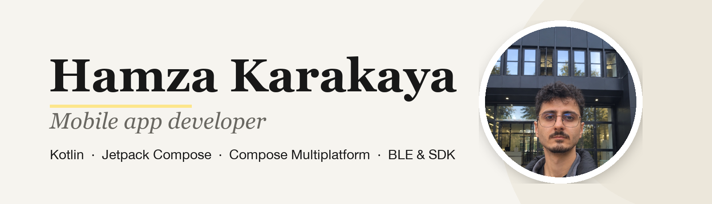
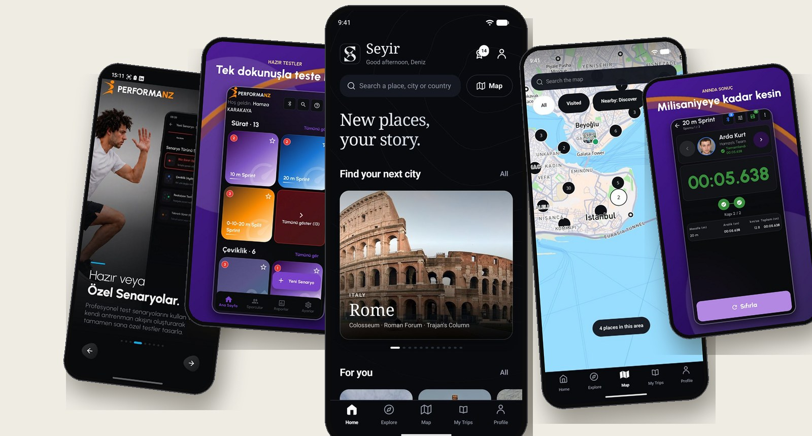

  

  

  
  
  
  
  

## About me

I'm a mobile app developer working on Android. I started in 2021 with Java, moved to Kotlin in 2022 and 2023, and have been building apps professionally for over a year and a half at **Performanz ArGe** in İzmir. I like well-structured code (Clean Architecture, MVVM) and I work where the phone talks to the outside world: apps that connect to sports and exam hardware over **Bluetooth Low Energy**, SDKs and device-to-device data communication.

My apps have been used in the field at the **ÖSYM ÖZYES exam**, the **Ministry of Youth and Sports Talent Screening** and **Fenerbahçe Basketball tryout camps**. To carry my Android experience to other platforms I'm learning **Compose Multiplatform** and applying it in my personal project, Seyir.

  

## Featured work

| Project | What it is | Built with |
|---|---|---|
| **[Seyir](https://seyirapp.pages.dev)** *(personal)* | Travel journal: discover places, save the ones you want to visit, keep memories with photos and notes. Offline-first, TR/EN catalog of 2,000+ places | Compose Multiplatform · SQLDelight · Supabase · Mapbox · Koin · Ktor |
| **[Performanz Fotosel](https://play.google.com/store/apps/details?id=nz.performanz.fotosel)** | Speed and agility measurement with a photocell gate sensor over BLE. I handled its Google Play releases | Kotlin · Jetpack Compose · BLE |
| **[Performanz Spark](https://play.google.com/store/apps/details?id=nz.performa.sparkKotlin)** | Speed, agility and reaction measurement over BLE. I handled its Google Play releases | Kotlin · BLE |
| **Apex · Fenerbahçe Basketball** | Runs athlete tests at the 2025 and 2026 tryout camps: connects to test devices over BLE, collects measurements, shows performance analysis | Kotlin · Jetpack Compose · BLE |
| **Sports Talent Screening (GSB)** | Worked on version V6.0 of the app used in the field for the Ministry of Youth and Sports' nationwide screening; fixed critical issues | Kotlin · Android |
| **ÖSYM ÖZYES** | SDK library and device-to-device data communication layer for exam hardware; GoPro video recording integration | Android · Kotlin · SDK |

## Tech stack

  

| | |
|---|---|
| **Languages** | Kotlin · Java |
| **Android & UI** | Jetpack Compose · Navigation Compose · Material Design 3 · WindowSizeClass |
| **Architecture** | Clean Architecture · MVVM · Repository Pattern · SOLID · Hilt · Koin |
| **Async** | Coroutines · Flow · StateFlow |
| **Data, network & cloud** | Room · SQLDelight · Retrofit · OkHttp · Ktor · REST · Firebase · Supabase · Cloudflare Pages |
| **Multiplatform** | Kotlin Multiplatform · Compose Multiplatform |
| **Hardware** | Bluetooth Low Energy (BLE) · USB · SDK development |
| **Tools & practices** | Android Studio · Xcode · Git · Gradle · Google Play Console · Agile · Refactoring · Claude Code · Codex |

## Experience

| When | Where | Role |
|---|---|---|
| Mar 2025 to now | Performanz Ar-Ge ve Yazılım Hizmetleri A.Ş. | Android Developer |
| Jan 2024 to May 2024 | İnci GS Yuasa | Mobile Application Developer Intern |
| Jun 2022 to Jul 2022 | EmlakJet | Android Developer Intern |

**Education:** B.Sc. Computer Engineering, Manisa Celal Bayar University (2019 to June 2024).

## Public projects

| Repository | Description |
|---|---|
| [WeatherForecastCompose](https://github.com/karakayahamza/WeatherForecastCompose) | Weather app (HavaNabzı) with Jetpack Compose, MVVM, Hilt, Retrofit, Flow and Lottie |
| [NoteAppCompose](https://github.com/karakayahamza/NoteAppCompose) | Note-taking app with Jetpack Compose, Hilt, Room and Navigation Compose |
| [SwapEase](https://github.com/karakayahamza/SwapEase) | Peer-to-peer item exchange app with Firebase and MVVM |

Say hi: <a href="mailto:hamza.karakaya77@outlook.com">hamza.karakaya77@outlook.com</a>

